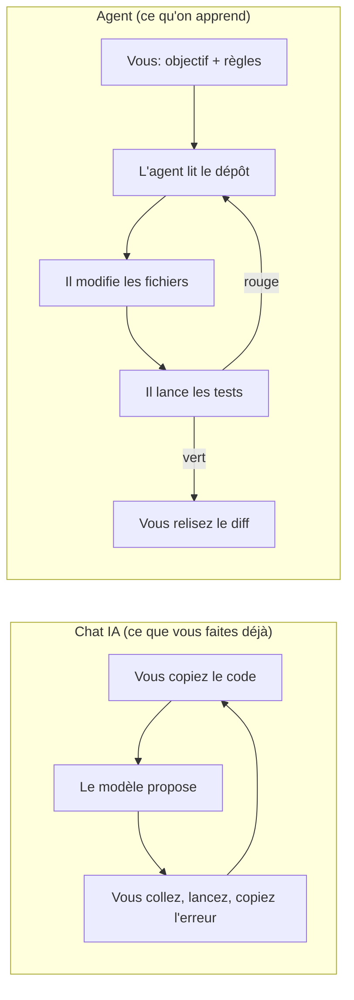
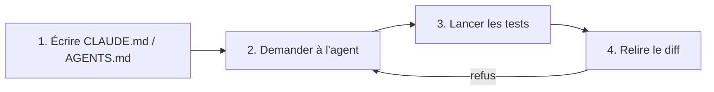

# Formation agentique — Niveau 1 : « Le premier bug corrigé »

Public : développeurs qui utilisent un chat IA mais jamais un agent. Durée : une demi-journée.
Objectif : chacun écrit le fichier d'instructions de son dépôt, un agent corrige un vrai bug, on relit son diff ensemble.

## 1. Chat vs agent : la boucle change de mains



Différence clé : dans le chat, **vous** êtes la boucle (copier/coller/exécuter). Avec un agent, la boucle tourne seule ; votre travail se déplace **avant** (cadrer : fichier d'instructions, critère de fin = tests) et **après** (relire le diff).

## 2. Les 4 étapes



1. **Fichier d'instructions** — `CLAUDE.md` (Claude Code) ou `AGENTS.md` (Codex CLI, OpenCode). Même contenu : projet, commande de test, règles. Partir de `CLAUDE.md.template` (10 lignes). Astuce : garder un seul fichier et faire `ln -s CLAUDE.md AGENTS.md`.
2. **Demander** — une phrase : le symptôme (le ticket), le critère de fin (« `pytest -q` doit passer »). Ne pas dicter la solution.
3. **Tester soi-même** — relancer `pytest -q` : on ne croit pas l'agent sur parole.
4. **Relire le diff** — `git diff`, grille en 5 questions (§4). Accepter = commit ; refuser = relancer avec une consigne précise.

## 3. Commandes par outil

Dans `exercice/` (après `pip install pytest`). Interactif d'abord, puis la variante non interactive (« headless ») pour la démo.

| Outil | Lit | Interactif | Headless |
|---|---|---|---|
| Claude Code | `CLAUDE.md` | `claude` | `claude -p "Corrige le bug du ticket ; pytest -q doit passer." --permission-mode acceptEdits --allowedTools "Bash(pytest*)" Read Edit` |
| Codex CLI | `AGENTS.md` | `codex` | `codex exec --full-auto "Corrige le bug du ticket ; pytest -q doit passer."` |
| OpenCode | `AGENTS.md` | `opencode` | `opencode run "Corrige le bug du ticket ; pytest -q doit passer."` |
| Mistral Vibe | `AGENTS.md` | `vibe` | `vibe -p "Corrige le bug du ticket ; pytest -q doit passer." --workdir . --trust --auto-approve --max-turns 15 --max-price 1 < /dev/null` |

Variantes par outil :
- **Claude Code** : mode plan (`Shift+Tab`) pour faire proposer avant de modifier ; `/init` génère un premier `CLAUDE.md` à corriger à la main.
- **Codex CLI** : sandbox par défaut ; `--full-auto` = écriture dans le dépôt + exécution locale, sans réseau. `/init` crée un `AGENTS.md`.
- **Mistral Vibe** : modèle Mistral (mistral-large par défaut) ; `-p` = non interactif, garde-fous `--max-turns`, `--max-price`, `--enabled-tools` ; sans `--auto-approve`, l'approbation des outils suit l'agent choisi (`--agent`). Démo : `demo/run-vibe.md`.
- **OpenCode** : multi-fournisseurs, choix du modèle avec `/models` ou `opencode run -m <fournisseur/modèle>` ; `/init` crée `AGENTS.md`.

**Claude Code sans modèle Anthropic** : Claude Code peut parler à l'endpoint OpenCode Go (DeepSeek, etc.) au lieu des modèles Anthropic, par variables d'environnement :

```bash
# Clé OpenCode Go lue depuis votre gestionnaire de secrets (ou ~/.local/share/opencode/auth.json), jamais affichée ni commitée
export ANTHROPIC_BASE_URL="https://opencode.ai/inference/go/anthropic"   # pas /zen/go (401)
export ANTHROPIC_AUTH_TOKEN="$OPENCODE_GO_KEY"
export ANTHROPIC_API_KEY=""                                             # vide : force l'usage du token ci-dessus
export ANTHROPIC_MODEL="deepseek-v4.1-flash"
export ANTHROPIC_SMALL_FAST_MODEL="deepseek-v4.1-flash"
export CLAUDE_CONFIG_DIR="$HOME/.claude-opencode-go"                    # config isolée de votre Claude Code habituel
claude
```

Notes : un avertissement `unrecognized_model` de Claude Code est sans conséquence ; un `429 Go usage limit exceeded` signifie quota hebdomadaire OpenCode Go épuisé. Liste des modèles : `GET https://opencode.ai/zen/go/v1/models` avec la clé en Bearer.

Message pédagogique : **la méthode (instructions + tests + revue de diff) ne dépend ni de l'outil ni du modèle.**

## 4. Grille de revue du diff (critères de réussite)

| # | Question | Réussi si |
|---|---|---|
| 1 | La **cause** est-elle corrigée, ou seulement le symptôme ? | On sait expliquer le bug en une phrase et le diff le vise. |
| 2 | Les **tests** sont-ils intacts et verts ? | Aucun test supprimé/affaibli ; `pytest -q` vert relancé par vous. |
| 3 | Le diff est-il **minimal** ? | Pas de refactoring, reformatage ou fichier hors sujet. |
| 4 | Les **cas limites** tiennent-ils ? | Ex. : 0 produit, nombre exact de pages, page hors limites. |
| 5 | Pourriez-vous **défendre ce diff en revue** d'équipe ? | Vous le comprenez ligne à ligne, sans l'agent. |

5/5 = commit. Un seul « non » = refus motivé, renvoyé à l'agent.

## 5. Limites et risques

- **Confiance excessive** : un agent affirme « c'est corrigé » même quand ce n'est pas vrai → les tests et la relecture font foi.
- **Tricher sur les tests** : modifier l'assertion au lieu du code. Interdit dans le fichier d'instructions, vérifié par la question 2.
- **Permissions** : un agent exécute des commandes. Démarrer en mode qui demande confirmation ; limiter les outils autorisés en headless.
- **Secrets** : ne jamais mettre de clé dans `CLAUDE.md`/`AGENTS.md` ni dans le prompt ; l'agent lit tout le dépôt (`.env` compris).
- **Code et données envoyés au fournisseur** : vérifier la politique de l'entreprise avant de lancer un agent sur un dépôt client.
- **Coût et quotas** : chaque boucle consomme des tokens ; un quota épuisé arrête l'outil (prévoir un 2e outil).
- **Non-déterminisme** : deux participants n'obtiendront pas le même diff — c'est une matière de discussion, pas un problème.
