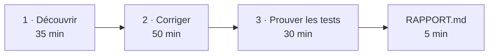

# Mini-projet 1 : « Comprendre, corriger, prouver »

> Niveau 1, environ 2 h, tout se fait **en local**. Avec Claude Code, Codex CLI, OpenCode ou Mistral Vibe : même exercice.
> Ce qu'on entraîne : **votre méthode avec un agent**. Dans chaque partie, quatre gestes : **cadrer** la tâche, **exiger des preuves**, **vérifier** par le comportement, les tests et les résultats, **décider** ce qu'on accepte ou refuse. On ne relit pas le code ligne à ligne.

**Le dépôt :** `exercice/`, une petite appli de facturation que vous n'avez jamais vue (import CSV de commandes, totaux avec remises et TVA, export). Ses tests sont tous verts. Un client écrit : *« Sur certaines commandes, le total facturé est faux de quelques centimes. »*

## Démarrer

```bash
cd exercice
make install     # crée .venv, installe pytest et mutmut
make test        # tous les tests passent
make total       # totaux de donnees/commandes-exemple.csv
```

Sans `make` : `python3 -m venv .venv && .venv/bin/pip install pytest mutmut`, puis `.venv/bin/pytest -q`, `.venv/bin/python -m facturation total donnees/commandes-exemple.csv`, `.venv/bin/mutmut run`, `.venv/bin/mutmut results`.



## 1 · Découvrir le code par son comportement (35 min)

- **Cadrer :** agent en **lecture seule / plan**. Demandez-lui comment on installe, lance et teste l'appli, ce que fait chaque commande, et de **prédire la sortie** de 5 situations (un CSV vide, une quantité négative, une colonne manquante…).
- **Exiger des preuves :** pour chaque affirmation, sur quoi elle repose (fichier lu, commande lancée).
- **Vérifier :** lancez vous-même `make total FICHIER=...` sur ces situations et comparez.
- **Décider :** gardez ce qui est confirmé dans le fichier d'instructions (`CLAUDE.md` ou `AGENTS.md`), notez dans `RAPPORT.md` ce qui était juste ou faux.

## 2 · Corriger le problème du client (50 min)

- **Cadrer :** demandez à l'agent de **reproduire** le problème : trouver quelles données le déclenchent et écrire un test qui échoue. Pas de correction avant ce test rouge.
- **Exiger des preuves :** le test rouge avant, vert après (`make test`) ; la cause en une phrase.
- **Vérifier :** relancez vous-même les tests et `make total` : total avant/après, et **deux cas que vous inventez**.
- **Décider :** acceptez seulement si la cause expliquée colle à ce que vous observez ; sinon, refusez et recadrez.

## 3 · Vérifier que les tests protègent vraiment (30 min)

- **Cadrer :** demandez à l'agent de lancer le test par mutation (`make mutants` puis `make survivants`) : l'outil `mutmut` introduit de petites erreurs dans le code et regarde si les tests les attrapent ([dépôt](https://github.com/boxed/mutmut)).
- **Exiger des preuves :** pour 3 mutants survivants, le **comportement qu'ils casseraient**, montré par une exécution.
- **Vérifier et décider :** relancez `make mutants` après les tests ajoutés ; acceptez un test s'il fait tomber le mutant, refusez ceux qui ne vérifient rien.

## Le rendu

Remplissez `exercice/RAPPORT.md` et joignez la trace de session.

## Selon votre outil (vérifié le 06/11/2026 sur les docs officielles)

| | Claude Code | Codex CLI | OpenCode | Mistral Vibe |
|---|---|---|---|---|
| Fichier d'instructions | `CLAUDE.md`, `/init` — [doc](https://code.claude.com/docs/en/memory) | `AGENTS.md`, `/init` — [doc](https://developers.openai.com/codex/learn/best-practices) | `AGENTS.md`, `/init` — [doc](https://opencode.ai/docs/rules/) | `AGENTS.md` — [doc](https://github.com/mistralai/mistral-vibe) |
| Lancer | `claude` | `codex` | `opencode` | `vibe` |
| Lecture seule (partie 1) | Mode `plan` (Shift+Tab) — [doc](https://code.claude.com/docs/en/permission-modes) | `/plan`, sandbox `read-only` — [doc](https://learn.chatgpt.com/docs/agent-approvals-security?surface=cli) | Agent Plan (Tab) — [doc](https://opencode.ai/docs/agents/) | Agent `ask` — [doc](https://github.com/mistralai/mistral-vibe) |
| Trace à rendre | `/export` (pas de page officielle trouvée, à tester) | Historique sous `CODEX_HOME` — [doc](https://learn.chatgpt.com/docs/agent-approvals-security?surface=cli) | `opencode export <session> --sanitize` — [doc](https://opencode.ai/docs/cli/) | `~/.vibe/logs/<session>/messages.jsonl` — [doc](https://github.com/mistralai/mistral-vibe) |

### Variante : Claude Code sans modèle Anthropic

**Claude Code sans modèle Anthropic** : Claude Code peut parler à l'endpoint OpenCode Go (DeepSeek, etc.) au lieu des modèles Anthropic, par variables d'environnement :

```bash
# Clé OpenCode Go lue depuis votre gestionnaire de secrets (ou ~/.local/share/opencode/auth.json), jamais affichée ni commitée
export ANTHROPIC_BASE_URL="https://opencode.ai/inference/go/anthropic"   # pas /zen/go (401)
export ANTHROPIC_AUTH_TOKEN="$OPENCODE_GO_KEY"
export ANTHROPIC_API_KEY=""                                             # vide : force l'usage du token ci-dessus
export ANTHROPIC_MODEL="deepseek-v4.1-flash"
export ANTHROPIC_SMALL_FAST_MODEL="deepseek-v4.1-flash"
export CLAUDE_CONFIG_DIR="$HOME/.claude-opencode-go"                    # config isolée de votre Claude Code habituel
claude
```

Notes : un avertissement `unrecognized_model` de Claude Code est sans conséquence ; un `429 Go usage limit exceeded` signifie quota hebdomadaire OpenCode Go épuisé. Liste des modèles : `GET https://opencode.ai/zen/go/v1/models` avec la clé en Bearer.

Message pédagogique : **la méthode (instructions + tests + revue de diff) ne dépend ni de l'outil ni du modèle.**

> **Pour aller plus loin (niveau suivant, facultatif, hors mini-projet 1)**
> Une façon de faire parmi d'autres : répartir les rôles entre plusieurs modèles, par exemple l'un écrit les tests, un autre écrit le code, un troisième vérifie. Ça peut donner une chaîne plus solide et coûter moins cher, puisque chaque rôle n'a pas besoin du modèle le plus gros. C'est une idée ouverte à essayer, pas une recette ni une norme.
